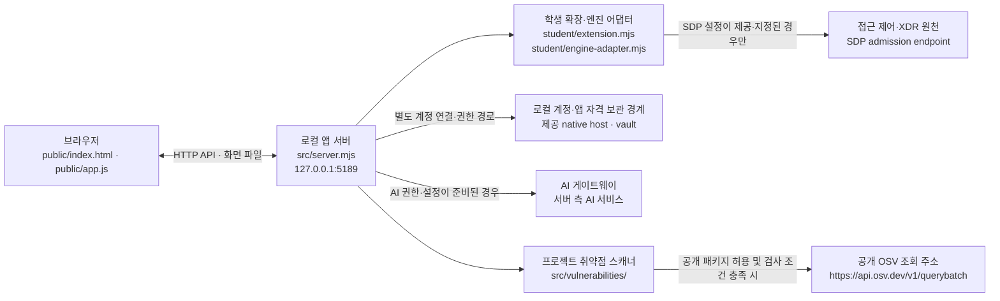

# 케셰브(KESHEV) 학생용 실행 설명서

이 문서는 다른 학생이 프로젝트의 실제 폴더에서 케셰브를 실행하고, 화면에 표시되는 상태가 무엇을 뜻하는지 확인하기 위한 안내입니다. 21단계에서 새로 만든 문서이며, 제공된 README와 실행 안내는 덮어쓰지 않습니다.

> 이 저장소 파일을 읽어 작성한 설명서입니다. 작성자가 실제 PC에서 설치·실행·브라우저 확인을 수행했다는 뜻은 아닙니다. 아래의 설치 버전·연결 기능·오류 복구는 코드에 적힌 계약과 실제 실행 결과를 구분해 설명합니다.

## 1. 앱의 목적과 기능

**케셰브(KESHEV)**는 직원이 자신의 로그인·기기 상태, 업무 앱 접근 요청 결과, 본인 접속 기록과 보안 경보를 확인하는 보안 Agent 앱입니다. 앱은 화면에 들어온 응답을 표시하며, 접근 허용 판정은 앱에 접속 허용 권한을 부여하는 것과 같지 않습니다.

현재 코드에 있는 기능과 조건은 다음과 같습니다.

| 기능 | 구현·입력 계약 | 상태와 한계 |
|---|---|---|
| 로그인·기기·세션 확인 | 브라우저가 `GET /api/me`를 요청합니다. 서버가 연결 엔진의 `readIdentity` 결과를 검증해 사용자·기기·세션 정보를 반환합니다. | 기본 실행은 기존 서버에 연결되지 않은 상태입니다. 실제 정보는 연결 엔진과 본인 범위 검증이 준비된 경우에만 확인됩니다. |
| 업무 앱 목록·접근 판정 | `GET /api/apps`로 목록을 읽고, `POST /api/access`에 `{ "appId": "..." }`를 보냅니다. 서버가 사용자·세션 범위를 확인한 뒤 `allow`, `deny`, `challenge` 또는 확인 불가 상태를 처리합니다. | 접근 판정은 해당 업무 앱 자체의 연결 성공을 뜻하지 않습니다. 요청·응답 실패를 허용으로 표시하지 않습니다. |
| 본인 기록·기기·세션 목록 | `GET /api/events`, `GET /api/devices`, `GET /api/sessions`를 사용합니다. 연결된 SDP 엔진은 본인 범위와 응답 형식을 확인합니다. | 실제 원천이 연결되지 않았거나 범위를 검증하지 못하면 정상적인 빈 목록으로 취급하지 않습니다. |
| 경보 설명과 앱 안의 AI 연결 | 사건 설명은 `POST /api/ai/explain`, 연결 점검은 `POST /api/ai/check`를 사용합니다. AI 연결 시작은 `POST /api/ai/connect/start`에 `{}`, 상태 확인·완료·취소는 각 요청의 `{ "connectionId": "..." }`를 사용합니다. | AI 연결·권한·모델 상태는 앱 서버의 시작 여부와 별개입니다. 열쇠나 토큰은 브라우저 화면에 전달하지 않습니다. 실제 유료 AI 요청은 이 문서 작성 과정에서 실행하지 않았습니다. |
| 패키지 취약점 조회 | `GET /api/vulnerabilities`가 서버의 프로젝트 스캐너를 호출합니다. 구성된 프로젝트의 `package-lock.json`과 설치 패키지 정보를 검증하고, 허용된 공개 패키지를 OSV 조회 계약에 따라 조회합니다. | 전체 상태는 `not_configured`, `not_checked`, `unverifiable`, `complete`, `partial`; 패키지 상태는 `known_vulnerabilities`, `none_found`, `unverifiable`입니다. 조회 불가·부분 결과는 취약점 없음과 다릅니다. |

학생이 수정하는 파일은 단계 안내가 지정한 `student/extension.mjs`입니다. 화면의 공통 틀과 요청 처리는 제공 코드인 `public/app.js`, 앱 서버와 연결 엔진은 `src/` 아래에 있습니다. 이번 문서 단계에서는 코드나 화면을 변경하지 않았습니다.

## 2. 지원 환경과 프로젝트 구조

### 필요 프로그램과 버전

| 항목 | 프로젝트에서 확인한 기준 | 이 PC에서 확인한 결과 |
|---|---|---|
| Node.js | `package.json`의 `engines.node`는 `24.19.0`입니다. `tools/start-alekov.ps1`은 주 버전 22~24를 허용하고, 24.19.0을 수업 기준으로 안내합니다. | 확인하지 않음. PowerShell에서 `node --version`으로 직접 확인하세요. |
| npm 설치 패키지 | `package.json`에 외부 npm dependency 목록이 없습니다. 이 프로젝트 파일에서 `package-lock.json`을 찾지 못했습니다. 실행 스크립트는 Node.js로 `src/server.mjs`를 바로 시작합니다. | 패키지 설치나 `npm install`은 실행하지 않았습니다. |
| 운영체제·브라우저 | 제공 실행 도구는 Windows PowerShell을 대상으로 합니다. 브라우저 주소는 로컬 loopback 주소입니다. | 실제 Windows·브라우저 조합에서 실행 확인하지 않음. |

Node.js 22~24는 시작 스크립트가 허용하는 범위이고, `24.19.0`은 프로젝트가 지정한 버전이자 수업 기준입니다. 둘을 같은 의미로 보지 마세요. 시작 스크립트는 허용 범위 안에서 기준 버전과 다르면 참고 메시지를 냅니다. 실제 설치 버전을 이 문서에서 확인했다고 주장하지 않습니다.

### 실제 경로와 폴더 구조

아래에서 `on-client`는 이 프로젝트 안의 앱 폴더입니다. PowerShell 실행 위치도 이 폴더여야 합니다. 저장소 최상위 폴더는 그 위의 프로젝트 폴더이므로, 앱 실행 위치와 Git 커밋 위치를 혼동하지 마세요.

```text
프로젝트 폴더/
└─ on-client/                         앱 폴더
   ├─ package.json                    Node.js 버전·실행 스크립트
   ├─ public/
   │  ├─ index.html                   브라우저 문서
   │  ├─ app.js                       제공 화면·브라우저 요청 코드
   │  ├─ style.css                    제공 화면 스타일
   │  └─ vulnerabilities-view.mjs     제공 취약점 조회 표시 모듈
   ├─ student/
   │  ├─ extension.mjs                학생 단계별 구현 파일
   │  └─ engine-adapter.mjs           제공된 연결 어댑터 경계
   ├─ src/
   │  ├─ server.mjs                   로컬 HTTP 서버·API 경계
   │  ├─ engine.mjs                   제공 연결 엔진 경계
   │  ├─ engine/                      SDP 설정·서버 연결 모듈
   │  ├─ ai/                          앱 안 AI 서비스·자격 보관 모듈
   │  ├─ connection/                  계정·AI 연결 관리자
   │  └─ vulnerabilities/             잠금 파일 검사·OSV 조회 모듈
   ├─ tools/
   │  └─ start-alekov.ps1             학생용 실행 사전 확인·시작 도구
   └─ docs/
      └─ STUDENT_RUNBOOK.md           이 학생용 실행 설명서
```

구조도는 이 단계에서 설명에 필요한 실제 경로만 적었습니다. `public/`, `src/`, `tools/`는 제공 코드이며, 단계 안내가 별도로 허용하지 않는 한 수정하지 않습니다.

## 3. 실행·종료·재실행

### 실행 전

1. 기존 프로젝트 폴더를 보존합니다. 새 폴더로 옮기거나 기존 작업을 삭제할 필요가 없습니다.
2. 파일 탐색기에서 실제 앱 폴더 `on-client`를 엽니다.
3. 폴더 창의 주소 표시줄에 `powershell`을 입력하고 Enter를 눌러 **그 폴더에서** PowerShell을 엽니다. 프롬프트 경로 끝이 `\on-client>`인지 확인합니다.
4. Node.js 버전을 확인하려면 다음을 실행합니다.

```powershell
node --version
```

`v24.19.0`은 프로젝트·수업 기준입니다. 시작 도구는 v22~v24를 허용합니다. Node.js가 없거나 지원 범위 밖이라는 시작 도구 메시지가 나오면 아래 오류 표를 따르세요.

### 시작

같은 `on-client` PowerShell에서 아래 명령을 실행합니다.

```powershell
powershell -NoProfile -ExecutionPolicy Bypass -File .\tools\start-alekov.ps1
```

이 프로젝트에는 `tools/start-alekov.ps1`이 있으므로 이 도구를 기본 실행 절차로 사용합니다. 실행 도구는 앱 폴더·시작 파일·Node.js·기본 포트 5189를 확인하고, 서버가 loopback 주소에서 HTTP 200으로 응답하는지 기다립니다. 프로그램을 설치하거나 포트를 점유한 다른 프로그램을 종료하지 않습니다. `-ExecutionPolicy Bypass`는 이 명령으로 시작하는 PowerShell 실행에만 적용되며, PC의 실행 정책을 바꾸지 않습니다.

정상 시작 신호는 다음 두 메시지입니다. 실제로 같은 문구가 표시되는지는 직접 실행해 확인하세요.

```text
케셰브가 켜졌습니다. 브라우저에서 http://127.0.0.1:5189/ 을 여세요.
서버가 응답한 것만 확인했습니다. AI 연결 상태는 화면에서 따로 확인해 주세요.
```

이어서 브라우저에서 다음 주소를 엽니다.

```text
http://127.0.0.1:5189/
```

앱 화면이 열리고 보호 현황과 기능별 상태가 표시되는지 확인합니다. 서버가 응답했다는 신호는 로컬 앱 서버의 시작 확인일 뿐, SDP 접근 제어·XDR 연결, AI 연결, 취약점 조회, 또는 단계 통과를 증명하지 않습니다.

### 종료와 재실행

- 기본 실행을 종료하려면 실행을 유지하는 PowerShell 창에서 `Ctrl+C`를 누릅니다. 실행 도구가 자식 Node 서버의 종료를 기다립니다.
- 다시 켜려면 같은 앱 폴더에서 위 시작 명령을 다시 실행하고 같은 브라우저 주소를 엽니다.
- 브라우저 화면을 닫는 것만으로 서버 종료를 확인할 수는 없습니다. 실행 중인 PowerShell 창에서 종료하세요.
- 포트 5189가 사용 중이라는 안내가 나오면 기존 프로그램을 종료하지 말고 시작 명령 끝에 `-Port 5190`을 붙입니다. 그 경우 브라우저 주소도 `http://127.0.0.1:5190/`으로 맞춥니다.

## 4. 시스템 구성도와 데이터 흐름



흐름을 글로 풀면 다음과 같습니다.

1. 브라우저와 앱 서버 사이의 HTTP 통신은 현재 PC 내부의 `127.0.0.1` 주소만 사용합니다. 서버는 브라우저에 제공 화면 파일과 학생 확장 파일을 돌려주고 `/api/...` 요청을 처리합니다.
2. 업무 앱·접근 판정·기록의 원천은 로컬 서버가 학생 코드에 제공하는 엔진 기능입니다. `student/engine-adapter.mjs`는 제공된 호스트 기능을 전달합니다. 실제 SDP 연결은 실행에 별도 SDP 설정이 지정된 경우에만 구성되며, 연결 정보와 자격은 브라우저에 전달되지 않습니다.
3. 앱 안 AI는 접근 제어·XDR과 다른 경로입니다. 로컬 서버의 AI 서비스와 별도 계정 승인·앱 자격 보관 경계를 사용합니다. 앱이 시작된 사실만으로 AI 게이트웨이에 연결되지 않습니다.
4. 취약점 스캔은 서버에서 프로젝트 파일을 확인합니다. 승인된 공개 패키지와 설치 정보를 검증한 경우에만 공개 OSV 주소로 조회합니다. OSV 조회를 하지 않았거나 검증하지 못한 상태는 취약점이 없다는 결론이 아닙니다.

이 구성도는 소스에서 확인한 모듈과 조건을 나타냅니다. 이 PC에서 SDP, AI 게이트웨이, OSV에 실제 연결되는지 시험하지 않았습니다.

## 5. 제공 코드와 학생 작성 코드의 경계

| 코드·기능 | 구분 | 확인한 책임·입력 | 이 문서 단계에서 한 일 |
|---|---|---|---|
| `student/extension.mjs` | 학생 작성 영역 | 과제 단계별 앱 확장 로직. 현재 단계는 문서 작성이므로 화면 동작을 바꾸지 않습니다. | 코드를 수정하지 않음. |
| `student/engine-adapter.mjs`의 `createEngine(host)` | 제공 코드 | `projectId`, `readIdentity`, `readApps`, `decideAccess` 기능을 검증해 전달하고, 실제 구현이 있을 때 본인 범위의 events/devices/sessions 조회를 선택적으로 전달합니다. | 수정하지 않음. |
| `src/server.mjs`의 `createOnServer(...)`와 API 라우트 | 제공 서버 코드 | 브라우저 요청 형식·로컬 Host·Origin·응답 자료를 검증하고 API별 제공 기능을 연결합니다. 예: `/api/access` 입력은 `appId`; AI 연결의 start 입력은 빈 객체, 나머지는 `connectionId`. | 수정하지 않음. |
| `src/engine.mjs`의 `loadEngine(...)`, `engineMethod(...)` | 제공 서버 코드 | 서버 실행 설정으로 연결 엔진을 불러옵니다. 연결 기능이 없으면 `ENGINE_NOT_CONNECTED`를 반환하는 경계가 있습니다. | 수정하지 않음. |
| `src/engine/sdp-host.mjs`의 `createSdpHostEngine(...)` | 제공 서버 코드 | 서버 전용 SDP 설정으로 본인 범위의 ID·앱·접근 판정·기록·기기·세션을 확인합니다. | 수정하지 않음. |
| `src/connection/manager.mjs`의 `createConnectionManager(...)` | 제공 서버 코드 | AI 연결 요청·승인 대기·완료·상태·취소를 서버 측에서 처리합니다. 공개 연결 상태는 `awaiting_approval`, `checking`, `connected`, `error`, `unknown`, `cancelled` 중 하나입니다. | 연결을 시작하거나 취소하지 않음. |
| `src/vulnerabilities/project-scan.mjs`의 `createProjectScanner(...).scan(...)` | 제공 서버 코드 | 서버가 구성된 프로젝트의 잠금 파일·실제 설치 메타데이터를 검증하고 조회 상태를 반환합니다. | OSV 조회를 실행하지 않음. |
| `public/app.js`, `public/vulnerabilities-view.mjs`, `public/index.html`, `public/style.css` | 제공 브라우저 코드 | API 호출·화면 구조·취약점 상태의 안전한 표시를 담당합니다. | 화면·DOM을 수정하지 않음. |
| `tools/start-alekov.ps1` | 제공 실행 도구 | Node·프로젝트 경로·포트와 로컬 HTTP 시작 응답을 확인하고 실행 안내를 표시합니다. | 실행하지 않음. |

`public/app.js`, `src/`, 시작 도구, 기존 학생 코드는 이 문서 작성 때문에 변경되지 않았습니다. 이 표는 소스에서 확인한 책임 설명이며, 실제 화면에서 각 기능이 성공했다는 시험 결과는 아닙니다.

## 6. 오류별 확인 순서와 복구

| 보이는 상황·코드 | 확인 방법 | 다음 조치 | 이 문서 작성자가 실행한 결과 |
|---|---|---|---|
| 시작 도구가 Node.js를 찾지 못함 또는 버전 오류 | `node --version`을 실행하고 안내가 요구한 지원 범위와 비교합니다. | 안내된 Node.js 버전을 설치한 뒤 새 PowerShell 창에서 같은 앱 폴더의 시작 명령을 다시 실행합니다. | 미확인 |
| `앱 폴더가 아닙니다`, 시작 틀 파일 누락, 링크 경로 거부 | PowerShell 경로 끝이 실제 `on-client`인지, `tools/start-alekov.ps1`, `package.json`, `src/server.mjs`가 있는지 확인합니다. | 실제 프로젝트의 앱 폴더에서 다시 실행합니다. 파일을 옮기거나 프로젝트를 지우지 않습니다. | 미확인 |
| `포트 5189` 사용 중 | 시작 도구의 포트 충돌 메시지를 확인합니다. 기존 프로그램을 종료하지 않습니다. | `-Port 5190`으로 다시 시작하고 브라우저도 `:5190` 주소로 엽니다. | 미확인 |
| 서버가 정해진 시간 안에 응답하지 않음 | PowerShell 창의 오류 문구와 실행 위치를 확인합니다. 실행 도구는 기본 20초까지 기다립니다. | 문구를 보존해 담당자에게 확인합니다. 연결 원인을 추측하거나 프로젝트를 재설치하지 않습니다. | 미확인 |
| 브라우저에서 페이지가 열리지 않음 | 서버 실행 창이 아직 열려 있는지, 메시지에 적힌 포트와 브라우저 주소가 같은지 확인합니다. | 서버를 종료했다면 같은 폴더에서 다시 시작합니다. 오류가 계속되면 문구를 확인받습니다. | 미확인 |
| AI 연결 상태가 `awaiting_approval` 또는 `checking` | 앱의 AI 연결 상태와 표시된 연결 ID 진행 상태를 확인합니다. | 현재 화면의 상태 확인 절차를 따릅니다. 승인이 끝나기 전에는 연결 완료로 보지 않습니다. | 실제 승인·AI 요청 미실행 |
| AI 연결 상태가 `unknown`, `error`, 확인 불가 또는 ALEKOV 오류 코드 | 화면의 상태·오류 코드와 기존 `docs/CONNECTION_TROUBLESHOOT.md` 안내를 대조합니다. | 자동으로 새 자격을 만들거나 취소·재시도하지 말고, 안내에 맞춰 담당자에게 확인합니다. 비밀값은 공유하지 않습니다. | 미확인 |
| 접근·기록 조회가 연결되지 않거나 `ENGINE_NOT_CONNECTED`, `SUBJECT_SCOPE_UNVERIFIED`, `ENGINE_RESULT_UNVERIFIED` | 실제 SDP 설정이 제공·지정되었는지와 화면의 정확한 상태·코드를 확인합니다. | 연결이 설정되지 않은 기본 상태를 성공이나 정상 빈 목록으로 바꾸지 않습니다. 실제 연결이 필요한 경우 담당자 안내를 따릅니다. | 실제 SDP 연결 미실행 |
| 취약점 상태가 `not_configured`, `not_checked`, `partial`, `unverifiable` 또는 API 오류 | 전체 스캔 상태, 패키지별 상태, 잠금 파일·패키지 정보 여부를 화면에서 구분합니다. | `none_found`와 혼동하지 않습니다. 승인·설정·조회 실패 원인을 화면 메시지와 기존 안내에 따라 확인합니다. | OSV 조회·화면 미확인 |

상태 이름·API 상태값·오류 코드는 코드 계약의 값 그대로 적었습니다. 색상만으로 결과를 판단하지 말고 화면의 상태 텍스트와 코드도 확인하세요. 연결되지 않은 기능의 원인을 코드에 없는 사유로 단정하지 않습니다.

## 7. 확인된 것과 확인하지 않은 것

**코드와 프로젝트 문서에서 확인한 것:** 실행 파일 경로, package 스크립트와 Node 버전 선언, 로컬 서버 주소·기본 포트, API의 입력·역할, 시작 스크립트가 검사하는 항목, 제공 코드와 학생 파일의 위치, 연결이 설정되지 않은 경우를 구분하는 코드 상태입니다.

**실제 실행으로 확인하지 않은 것:** 이 컴퓨터의 Node.js 설치 버전, 새 PowerShell에서 앱 시작, 브라우저 화면, 접근 제어·XDR 연결, 실제 AI 승인과 게이트웨이 요청, 취약점 OSV 응답, 연결 실패 복구 동작입니다. 현재 문서의 정상 시작 신호는 실행 도구에 적힌 출력 문구이며 실제 실행 결과가 아닙니다.

**지원 경계:** 실행 스크립트가 확인하는 주 버전은 Node.js 22~24입니다. `package.json`은 `24.19.0`을 지정합니다. 이 문서는 다른 운영체제에서의 실행, 실제 서버 자격·계정 설정, 외부 서비스 가용성이나 단계 통과를 보증하지 않습니다.

## 8. 21단계 제출 유의사항

21단계의 제출 방식은 이번 단계 화면의 공식 안내를 따릅니다. 이 단계에서는 학생 문서와 해당 단계 변경사항을 같은 커밋에 포함하고, 과제 화면에 저장소 주소와 40자리 커밋을 직접 입력합니다. 비공개 저장소를 공개로 바꿀 필요는 없습니다.

비공개 커밋의 원문이 필요하면 과제 화면에서 **「비공개 저장소 원문 준비 방법」**을 열고 **「원문 전달 도구 받기」**부터 사용합니다. ZIP과 결과 JSON을 저장할 폴더는 프로젝트 밖에 둡니다. 학생 코드를 실행하거나 업로드하지 않는 도구이므로, 실제 폴더 경로와 제출할 커밋을 확인한 뒤 과제 화면에 표시된 명령을 그대로 따릅니다. 이 문서는 PC별 경로·커밋 값을 알 수 없으므로 도구 명령을 만들어 적지 않습니다.

제출 후에는 원문 전달 상태와 AI 검토·판정 상태를 구분해 과제 화면에서 확인합니다. 원문 전달만 실패한 경우 기존 접수를 유지하고 화면의 **「원문만 다시 보내기」** 안내를 사용합니다. 여기서 커밋·푸시·제출·판정을 실행하거나 완료했다고 주장하지 않습니다.
